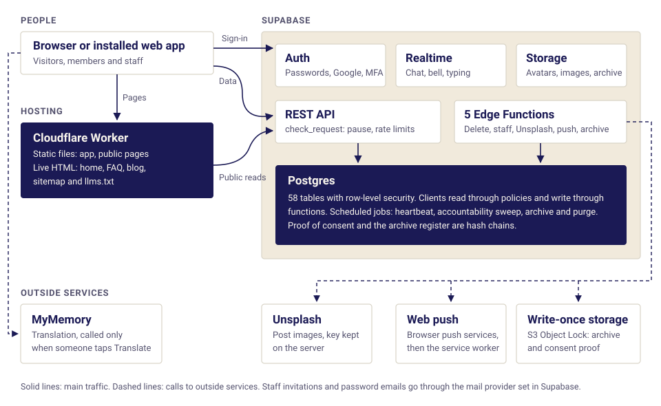

# Architecture



## The stack

| Layer | Technology | Notes |
|---|---|---|
| Frontend | React 18, Vite 5, TypeScript, React Router 6 | A single-page app, with public pages prerendered |
| Styling | Tailwind 3 and CSS variables, all from `src/theme/tokens.ts` | See [Design system](DESIGN_SYSTEM.md) |
| State | Zustand | One store per domain |
| Backend | Supabase | Postgres, Auth, Realtime, Storage and Edge Functions |
| Hosting | Cloudflare Worker `thefluencytalks` with static assets | `wrangler.toml` |
| Blog editor | Tiptap | Loaded only on the editor route |

Production is the Worker. It isn't Cloudflare Pages or Vercel. `vercel.json` is a leftover that nothing reads.

## Folder map

```
src/
  theme/        tokens.ts (source of truth) and inject.ts (tokens to CSS variables)
  styles/       index.css (app) and landing.css (public pages, scoped under .lp)
  components/
    ui/         Generic parts: Button, Input, Modal, Tabs, Avatar, RouteError ...
    features/   Domain parts: ProfileForm, LanguageSelect, UserMenu, ReportDialog ...
      admin/    Admin screens, MFA forms, and the blog/ editor
      chat/     ChatThread, MessageBubble, Composer, CorrectionDialog, DiffText ...
      library/  PostCard, HelpComposer, UnsplashPicker
      review/   Post review: Composer, DecisionQueue, ThreadItemRow
      search/   SearchBox, SearchFilters, PersonResult, MessageResult
    landing/    Public page parts: PublicShell, Hero, Header, Footer ...
    layout/     AppShell, TopBar, Sidebar, RightRail, BottomNav, AuthLayout, PageHeader
    legal/      LegalLayout
  pages/
    public/     Landing, Blog, BlogPost, FaqPage, LanguagesIndex, LanguagePage, About,
                Privacy, Terms, DataDeletion, Maintenance, NotFound
    auth/       Login, Signup, ForgotPassword, ResetPassword, AcceptInvite
    app/        Home, Search, Messages, Profile, Settings, Learning, BountyQueue,
                Notifications, PointsHistory, Onboarding, EditProfile, UserProfile
    features/   library/ (Library, PostDetail, contribute/) and partners/
    admin/      AdminLayout, AdminBottomNav, adminNav
  router/       Routes, ProtectedRoute, AdminRoute, PausedGate
  services/     Typed wrappers over database functions, one file per domain
  store/        Zustand stores
  hooks/        useSeo, usePresence, useNavBadge, useDebouncedValue ...
  lib/          api.ts, errors.ts, validate.ts, keyboard.ts, feedMix.ts, blogHtml.ts,
                supabase.ts (the only file that creates the client),
                translate.ts (the only file that talks to a translation provider)
  content/      languages.ts (the 40 language pages)
  types/        db.ts
  entry-server.tsx   Renders the public pages at build time
worker/         index.ts: the Cloudflare Worker
public/         robots.txt, llms.txt, sw.js, manifest, _redirects, _headers, images
scripts/        Build, checks, tests and owner tools (below)
supabase/
  migrations/   The schema, one file per area. See DATABASE.md
  functions/    Edge Functions, and _shared/ code
  tests/        app_flow.sql, privileges.sql, stubs.sql
  legal/        The exact text of each legal version
  seed.sql      Extra languages, local only
tests/unit/     Unit tests for pure helpers
```

## How a request flows

1. **Pages** compose components, and components call **services** and **stores**. They never call Supabase directly.
2. **Services** call `rpc()` in `src/lib/api.ts`, the single path to the database. It cleans every argument and turns failures into a safe `ApiError` ([App-wide rules](APP_WIDE_RULES.md)).
3. **PostgREST** runs `check_request()` before each request, for the pause switch and rate limits ([Security](SECURITY.md)).
4. **Database functions** check blocks, account status, staff login and limits.

**The core rule is that clients read through row-level security and write through functions.** The only direct writes are deleting your own phrases and translations.

```ts
import { searchPeople, sendMessage } from '@/services';
```

## Edge Functions

| Function | What it does | Called by |
|---|---|---|
| `delete-account` | Permanently deletes the calling user and their photos | The signed-in user |
| `admin-staff` | Staff actions that need the service role or the mailer, such as invitations and MFA resets | Staff |
| `unsplash-proxy` | Image search, so the key stays on the server | Signed-in users |
| `send-push` | Delivers one notification to the owner's devices | The database, after a row commits |
| `archive-run` | Moves old rows to storage, copies to write-once storage, destroys expired files | The database, on a clock |

`_shared/` holds the common code: `edge-gate.ts`, `notification-text.ts`, `archive-file.ts` and `worm.ts`.

## The Worker

`wrangler.toml` sends only these paths to `worker/index.ts`: `/`, `/faq`, `/blog`, `/blog/*`, `/sitemap.xml` and `/llms.txt`. Everything else is a plain file.

The Worker reads posts and FAQ questions from the database with the public anon key and returns finished HTML, cached at the edge for 60 seconds. App routes get `dist/app.html` with a 200 through `public/_redirects`. Unknown URLs get `dist/404.html` with a real 404. Details are in [SEO](SEO.md#5a-how-it-is-built-crawlable-html-).

## Realtime

Realtime is used in a few contained places, so it could be swapped for your own WebSocket layer later:

- `services/messaging.ts`: messages, corrections, reactions and read receipts
- `services/notifications.ts`: the notification bell
- `services/review.ts`: post review threads
- `hooks/usePresence.ts`: typing, over private channels checked against conversation membership
- `services/appStatus.ts`: the pause switch

## State

Zustand stores hold state shared across pages, one per domain: `authStore`, `themeStore`, `profileStore`, `languageStore`, `chatStore`, `notificationStore`, `partnersStore`, `badgeStore`, `countryStore`, `adminStore`, `appStatusStore`, `accountabilityStore`, `toastStore` and the `feedCache`.

## Scripts

| Script | What it does |
|---|---|
| `prerender.mjs` | Writes each public page as static HTML, plus `sitemap.xml`, `404.html` and `app.html` |
| `check-seo.mjs` | Checks what a crawler sees on the built site |
| `check-rpc-contract.py` | Fails if the app calls a database function that doesn't exist, or passes a parameter it doesn't have |
| `legal-text.mjs` | Records and checks the exact text of each legal version |
| `test-db.sh` | Builds a throwaway database and replays the app's flows |
| `test-auth.mjs`, `test-admin-mfa.mjs`, `test-security.mjs` | Auth helpers, staff and MFA end to end, and access rules. The last two run on the local stack only |
| `admin-accounts.mjs` | Owner tasks with the service role key: create the super admin, reset MFA or a password |
| `setup-push.sh` | One-time web push setup. **Touches production** |
| `indexnow.mjs` | Asks Bing and others to recrawl |
| `gen-tz-country.mjs` | Regenerates the time zone to country table |
| `build-docs-pdf.mjs` | Builds the shareable PDF of the project documentation |
| `og-image.html` | Source of the social sharing image |

## Portability

The goal is that leaving Supabase stays possible and touches few files.

- Schema changes are SQL migrations. Never click-edit tables in the dashboard.
- Supabase calls stay inside `lib/`, services and stores.
- Avoid Edge Functions and Supabase-only features where plain Postgres works.
- `delete-account` could become a small authenticated endpoint on your own backend calling the same admin API.
