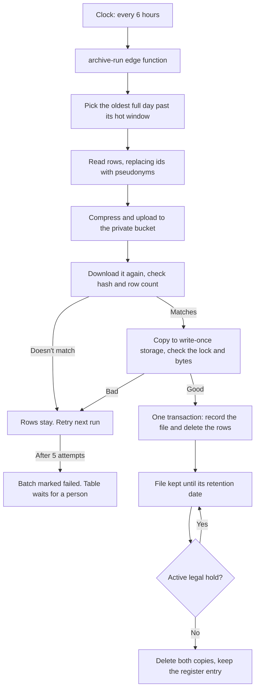

# Data retention and archiving

For whoever owns the Supabase project, and for whoever gives legal advice on it. It covers what we keep, for how long, where it goes, how it is destroyed, and what to do when something goes wrong.

**We follow Vietnamese law.** This was checked on 3 November 2026 against English translations of Law 91/2025/QH15 and Decree 356/2025/ND-CP, and a law firm's summary of Decree 333/2026/ND-CP. It's not legal advice: see [Legal compliance](LEGAL_COMPLIANCE.md), which also holds the open legal items and sources.

## In short

Logs and records that keep growing move out of the database once they are old enough to be rarely needed. They go into compressed files in private storage, with a second copy in write-once storage that nobody can alter or delete before its date. When the date comes, both copies are destroyed. A permanent register records every file, including when it was destroyed.

- **Nothing is deleted from the database until both copies have been read back and checked.** If any step fails, the rows stay where they are.
- **No write-once store, no archive.** Until one is connected, rows stay in the database and the Health page says so.
- **Proof of consent is kept permanently,** including after the account is deleted, and says who agreed, when and to what wording.
- **Tampering shows.** The consent ledger and archive register are hash chains, checked against write-once checkpoints on every run.
- **Archive files don't identify members directly.** User ids are replaced with pseudonyms, and deleting an account deletes the link back to that person.
- **A legal hold stops a file from being destroyed** for as long as the hold is active.

## What we keep, and for how long

"Hot" means in the database and visible in the admin area. "Total" counts from the row's date and includes the hot period.

### Archived, then destroyed

| Data | Table | Hot | Total | Counted from | Removed from the file |
|---|---|---|---|---|---|
| Application logs | `app_logs` | 30 days | 13 months | Created | `context` (page path, stack trace) |
| Staff audit log | `admin_audit_log` | 1 year | 5 years | Created | `target_email`, and the `email` inside `detail` |
| Restrictions, appeals, exemptions | `accountability_audit` | 1 year | 3 years | Created | Nothing |
| Bans and suspensions | `moderation_actions` | 1 year | 3 years | Created | Nothing |
| Safety reports and their evidence | `reports` | 1 year | 3 years | **Resolved** | Nothing |

An open report has no resolved date, so it never moves, however old it is.

### Why these periods

| Period | Legal basis |
|---|---|
| Any period at all | Data is kept for a period appropriate to its purpose unless the law says otherwise (Law 91/2025 Art. 3.3), and deleted when the purpose is fulfilled or the period ends (Art. 14.1). Most of these records have no fixed period in law, so the periods below are our judgment. |
| Logs: 13 months | System logs for investigating violations must be kept at least 12 months (Decree 333/2026 Art. 20.3). The extra month is a margin. |
| Reports, decisions: 3 years | Matches the limitation period for civil claims (Civil Code 2015 Art. 429 and 588). Keeping these after someone objects or deletes an account relies on the exception for protecting rights and interests (Law 91/2025 Art. 19.1(a)), and we have to be able to justify that. |
| Staff audit log: 5 years | No period is set for this log. Decree 356/2025 Art. 29 sets at least 5 years for records of incidents involving location or biometric data, used here as a benchmark. |
| Proof of consent: permanent | The law requires us to store consent, and we carry the burden of proof in a dispute (Decree 356/2025 Art. 6.2). No end date is set. Your decision is to keep it always. |

### Proof of consent

Kept permanently in `consent_ledger`, separately from the `consents` table, and copied to write-once storage. It's added automatically whenever consent is recorded or ends.

| Consent must show (Decree 356/2025 Art. 6.1) | Held as |
|---|---|
| Who | `user_id`, and `email_hash` (SHA-256 of the lower-case address) so the person can be matched after their account is gone |
| When | `occurred_at`, with an `ended` entry when the account is deleted |
| What | `document_sha256`, pointing at the exact wording and page text in `consent_documents` |

No name and no plain email are kept. Consents given before this existed were copied in when the migration ran, using the v1 wording.

**Changing the privacy policy or terms:** CI fails until a new version is recorded. The steps are in [Legal compliance](LEGAL_COMPLIANCE.md#changing-the-privacy-policy-or-terms).

### Deleted with no archive

| Data | Table | Kept for | Why no archive |
|---|---|---|---|
| Uptime heartbeats | `system_heartbeats` | 90 days | No personal data, no later use |
| Push send records | `message_push_claims` | 30 days | Only stops a push being sent twice |
| **Read** notifications | `notifications` | 180 days after reading | Already seen. Unread ones stay. |
| Scheduler run history | `cron.job_run_details` | 14 days | Only used to show recent job status |

Rate limit counters already clean up after themselves (`rate_limit_cleanup`).

### Deliberately not archived

These stay in the database for as long as the account exists, and go when it is deleted.

- **Messages and chats.** The privacy policy says "your chats are yours" and that deleting an account removes them. Keeping a copy for years would contradict that, and nothing we've identified requires it. The only message text we keep is what a report captured as evidence.
- **Everything else a member owns:** profile, posts, corrections, phrases, translation history, points and consents.

## How it works



| Piece | Where | Job |
|---|---|---|
| `retention_policies` | Database | The rules: one row per table |
| `archive_batches` | Database | The register: one row per file, with hash, row count and dates. Never deleted. |
| `archive_legal_holds` | Database | Date ranges that must not be destroyed |
| `archive_subjects` | Database | Links a user id to its pseudonym. Deleted with the account. |
| `archive_settings` | Database | The function's URL and secret. Filled in by hand once. |
| `archive-run` | Edge function | Does the file work. All decisions about deleting are made in the database. |
| `archives` | Storage bucket | The working copy. Private, with no access policies, so only the service role can reach it. |
| Write-once bucket | S3 with Object Lock, outside Supabase | The tamper-proof copy of each file, the consent ledger, and checkpoints |
| `consent_ledger`, `consent_documents` | Database | Proof of consent, and the wording it refers to |
| `archive_checkpoints` | Database | Each checkpoint written to the write-once bucket |
| `ft-archive-run` | pg_cron, every 6 hours | Starts `archive-run` |
| `ft-archive-purge` | pg_cron, hourly | Runs the deletes that have no archive, up to 5,000 rows per table each hour |

### The files

Each file holds one UTC day of one table: `archives/<table>/<yyyy>/<mm>/<yyyy-mm-dd>.p<part>.ndjson.gz`. It's gzipped text with one JSON object per line, so it can be read for years without any of our code.

A sealed file is never changed. If a row later turns up for a day that is already archived, it goes into a new file (`.p2`).

### What protects the data

| Risk | What stops it |
|---|---|
| Rows deleted but a copy is bad | Rows are only deleted after the stored file is downloaded again and its SHA-256 and row count match, and the write-once copy is confirmed locked and byte-identical. The database refuses to seal a batch without it. |
| File recorded but rows not deleted, or the reverse | Both happen in one database transaction |
| Rows changed between reading and deleting | The row count is checked again before and after the delete. Any difference undoes the transaction and the batch retries. |
| Audit log deleted through this route | `admin_audit_log` stays append-only. Deleting is allowed only for rows in a batch being sealed, and that state exists only inside the sealing transaction. Updates are always refused. |
| A failure that keeps repeating | After 5 attempts the batch is marked failed and that table stops. Nothing is lost, and it shows in red on the Health page. |
| Someone calling the steps directly | The `svc_archive_*` functions are only for the service role, and the function requires its own secret |

## Tamper protection

There are three layers, because no single one covers everything:

| Layer | Stops or catches | Limit |
|---|---|---|
| Append-only triggers on the ledger, audit log, register and checkpoints | Mistakes, bugs, and anyone without table-owner rights | Someone with full database access can switch them off |
| Hash chains: each entry includes the hash of the one before | Any changed or removed entry | Someone who rewrites an entry and every later hash passes this check |
| Write-once storage, S3 Object Lock in COMPLIANCE mode | Everything above: the checkpoint it holds can't be changed, so a rewrite no longer matches it | Only covers what has been copied: anything newer than the last run (up to 6 hours) |

Every run walks both chains and compares them with the last good checkpoint. If they differ, the run writes an alert to write-once storage, and the Health page shows **RECORDS HAVE BEEN CHANGED**. It keeps failing until someone deals with it, so a forgery never becomes the new baseline.

**In COMPLIANCE mode nobody can remove a locked copy before its date:** not us, not the storage account's root user, and not the provider's support.

- A lock can be extended but never shortened. A mistake with a date can't be undone.
- That includes a deletion ordered by an authority (Law 91/2025 Art. 14.1) or a change in the law.
- A lock needs a date, so "permanent" records use 100 years.

**This doesn't stop** someone with the function's secrets from adding new, false entries going forward. Older copies still can't be changed, and comparing them with the database shows when it started. To limit this, use a separate account for the bucket, give the key only the permissions in [Setup](#setup), and turn on MFA for that account's root user.

### If the check fails

Treat it as a security incident: see [SECURITY.md](SECURITY.md). If personal data was affected in a way that could cause harm, the authority must be notified within 72 hours of discovery (Law 91/2025 Art. 23.1). To compare what was recorded:

```sql
select id, taken_at, checkpoint_key, integrity from public.archive_checkpoints order by id desc limit 10;
select public.svc_integrity_check();
```

## Deleted accounts

Files can't be rewritten, so they never hold a member's real id. They hold a random pseudonym from `archive_subjects`, and that row is deleted automatically with the account. From then on, nothing in our systems links any file to that person, without touching a single file. An account that is already gone when a file is written gets `null`.

This covers `user_id`, `actor_id`, `target_user`, `target_user_id`, `target_id`, `reporter_id`, and `sender_id` inside report evidence.

**What this doesn't do:**

- **Free text is not scrubbed.** Report details, message text in evidence, log messages and moderation reasons can contain a name someone typed. This is why deleting an account may reduce these files to pseudonymous rather than fully anonymous data, and legal should look at it.
- **Staff stay named** in `admin_audit_log` (`actor_id`, `actor_email`), and by id in `moderation_actions` (`admin_id`) and `reports` (`resolved_by`). They acted on behalf of the service, and this record is what makes the log useful as evidence. Those ids are only linked to a person while the account exists, except the audit log's `actor_email`, which stays in the file.
- **Proof of consent is the exception to all of this.** It keeps the real `user_id` and `email_hash` on purpose, because it has to show who agreed.
- **Hot rows follow their existing rules until they move.** `app_logs.user_id`, `admin_audit_log.target_email` and the `sender_id` in report evidence are not cleared when an account is deleted, so they can sit in the database for the rest of the hot period.
- **Database backups** still contain deleted rows until those backups age out, on whatever schedule your Supabase plan uses.

## Common tasks

Run the SQL in the Supabase dashboard's SQL editor. These tables aren't reachable from the API, on purpose.

### Place or lift a legal hold

Place a hold as soon as you know a claim, investigation or authority request is likely. Holds work on date ranges of the date the row is filed under. Use `null` for the table to cover everything. If you're unsure of the dates, go wide.

```sql
insert into public.archive_legal_holds (table_name, from_day, to_day, reason, placed_by)
values (null, '2026-01-01', '2026-06-30', 'Claim ref 123, per counsel', 'name of the person placing it');

-- Lifting: the row stays, as the record.
update public.archive_legal_holds set released_at = now(), released_by = 'name'
where id = '<hold id>';
```

**A hold does not protect an account.** If the person involved deletes their account, the link to their pseudonym goes, even under a hold. If you need to keep it, take a copy of the mapping first:

```sql
select user_id, pseudonym from public.archive_subjects where user_id = '<user id>';
```

### Find and read an archived record

1. Find the file in the register:
   ```sql
   select object_path, row_count, sha256, retain_until from public.archive_batches
   where table_name = 'reports' and status = 'released' and day between '2026-01-01' and '2026-01-31' order by day, part;
   ```
2. Download it from **Storage → archives** in the dashboard. If that copy is missing or doesn't match, use the write-once copy at `worm_key`, version `worm_version`.
3. Confirm it hasn't changed, then read it. The hash must match the register.
   ```bash
   sha256sum 2026-01-15.p1.ndjson.gz
   gunzip -c 2026-01-15.p1.ndjson.gz | jq .
   ```
4. To follow a person, look up their pseudonym, then search the files for it:
   ```sql
   select pseudonym from public.archive_subjects where user_id = '<user id>';
   ```

**Keep your own note of each retrieval: who, when, which file and why.** Dashboard downloads aren't written to our audit log.

Requests from members for their own data are still answered by the export in Settings, which reads live data only. If a request needs archived records too, follow these steps for that person's pseudonym.

### Prove someone consented

```sql
select l.seq, l.event, l.kind, l.version, l.occurred_at, l.document_sha256, d.wording, d.document_text
from public.consent_ledger l left join public.consent_documents d on (d.kind, d.version) = (l.kind, l.version)
where l.email_hash = public.email_hash('person@example.com') order by l.seq;
```

Check `select public.svc_integrity_check();` at the same time. For a dispute, also take the matching `consents/` file from write-once storage: its entries carry the same `entry_hash`, which is what shows the record wasn't made up later.

### Answer a request from a member

The law sets these limits (Decree 356/2025 Art. 5). They're also published on the privacy page. Each one starts with a reply within **2 working days**.

| Request | Finish within | If a provider has to act | One extension, at most |
|---|---|---|---|
| See, correct or get a copy | 10 days | 15 days | 10 days |
| Withdraw consent, limit or object | 15 days | 20 days | 15 days |
| Delete | 20 days | 30 days | 20 days |
| Protection measures | 15 days | | 15 days |

An extension needs a reason given to the person, and we have to be able to justify it. Nothing tracks these deadlines yet, so keep a dated note of each request.

### Retry a failed batch

Find out why it failed, and fix the cause first:

```sql
select id, table_name, day, last_error, attempts from public.archive_batches where status = 'failed';
```

Then send it back. The next run picks it up, and you can start one straight away with `select public.archive_kick();`.

```sql
update public.archive_batches set status = 'exporting', attempts = 0, last_error = null, claimed_at = null where id = '<batch id>';
```

### Change a retention period

```sql
update public.retention_policies set retain_days = 730, basis = 'Why it changed, and who approved it' where table_name = 'app_logs';
```

This applies to files written from now on. Files already written keep their date. You can move an existing file's date later, but the write-once lock can't be shortened: until it runs out, an earlier destroy date just fails and shows on the Health page.

### Add a table

Add a row to `retention_policies` in a new migration. An `archive` table needs an `id` column and a date column, must have no other table depending on its rows, and must list every column that holds a user id in `subject_columns`. Add a test to `supabase/tests/app_flow.sql` that checks no raw id reaches the file.

### Pause it

```sql
update public.retention_policies set enabled = false where table_name = 'app_logs';  -- one table
select cron.unschedule('ft-archive-run');                                            -- all archiving
select cron.unschedule('ft-archive-purge');                                          -- all deletes with no archive
```

Stopping `ft-archive-run` also stops destruction, which is a retention problem of its own if it's left off.

## Setup

The order matters. The migration stops the old 30-day log delete straight away, so **until this is finished, `app_logs` keeps growing and nothing gets archived**. No data is lost in that gap, and the Health page says so.

1. **Database.** Run `supabase db push`. It pushes every migration not yet applied, not only these. In the dashboard, check that **pg_cron** and **pg_net** are enabled under Database → Extensions.
2. **Write-once bucket.** Create it in a separate account from everything else, and set this up **when creating the bucket**, because Object Lock can't always be added later:
   - Object Lock: on. Versioning turns on with it. **Don't set a default retention or a lifecycle rule:** each file sets its own date, and only `archive-run` destroys things, because it checks for legal holds first.
   - Region: see [Legal compliance](LEGAL_COMPLIANCE.md#before-you-rely-on-this), since this is another cross-border transfer unless the bucket is in Vietnam.
   - A key limited to this bucket, with only `s3:PutObject`, `s3:PutObjectRetention`, `s3:GetObject`, `s3:GetObjectVersion`, `s3:GetObjectRetention`, `s3:ListBucketVersions`, `s3:DeleteObjectVersion`.
   - Any store that enforces COMPLIANCE-mode Object Lock through the S3 API will work. `archive-run` checks the lock on every write and refuses one that doesn't hold. It was tested against RustFS, not AWS, so watch the first real run.
3. **Function.**
   ```bash
   openssl rand -hex 32    # the secret: use the same value in step 4
   supabase secrets set ARCHIVE_WEBHOOK_SECRET=<secret> \
     ARCHIVE_WORM_ENDPOINT=https://s3.<region>.amazonaws.com ARCHIVE_WORM_REGION=<region> ARCHIVE_WORM_BUCKET=<bucket> \
     ARCHIVE_WORM_ACCESS_KEY_ID=<key> ARCHIVE_WORM_SECRET_ACCESS_KEY=<secret key>
   supabase functions deploy archive-run --no-verify-jwt
   ```
4. **Connect them** in the SQL editor:
   ```sql
   insert into public.archive_settings (function_url, webhook_secret)
   values ('https://<project-ref>.supabase.co/functions/v1/archive-run', '<secret>');
   ```
5. **Website.** Deploy as usual. This publishes the new privacy and deletion pages, the new consent version and the Health panel.
6. **Check it.**
   ```sql
   select jobname, schedule, active from cron.job where jobname like 'ft-archive%';   -- two rows
   select public.archive_kick();                                                      -- start a run now
   select status_code, content from net._http_response order by created desc limit 1; -- wait a few seconds first
   select taken_at, checkpoint_key, consent_key, integrity from public.archive_checkpoints order by id desc limit 1;
   ```
   The answer should have `"checkpoint":true` and no `"worm":"not configured"`, and the last query should show `"ok": true`. **Then try to delete the `checkpoint_key` object's version in the bucket: it must be refused.** If it isn't, the bucket isn't locking.

If `cron.job` shows no rows, enable pg_cron and run the two `cron.schedule` lines from `supabase/migrations/20261103101300_data_archive.sql`.

## Keeping an eye on it

**Admin → Health → Data archive** shows the state of all this. Anything it flags also appears in the banner at the top of the page. Failures in a run are also written to the logs, under `edge:archive-run`.

| It shows | Meaning | Do this |
|---|---|---|
| Archive set up: No | `archive_settings` is empty | [Setup](#setup), step 4 |
| Tamper-proof copy: Not connected, or more than 2 days old | Nothing has been written to write-once storage lately | Check the `ARCHIVE_WORM_*` secrets, then the function's logs |
| Integrity check: RECORDS HAVE BEEN CHANGED | The database no longer matches its write-once checkpoint | [If the check fails](#if-the-check-fails) |
| Failed archive files above 0 | A table has stopped archiving. Its rows are safe in the database. | [Retry a failed batch](#retry-a-failed-batch) |
| Oldest rows waiting, flagged | More than 2 days past the hot window: runs aren't happening | Check `ft-archive-run` under Scheduled jobs, then the function's logs. The usual cause is a mismatch between the secret and `archive_settings`. |
| Files past their destroy date above 0 | Files should have been destroyed and weren't. This is a retention breach if it lasts. | Same checks, then look for `destroy` errors in the logs |

Review this page at least once a month. Nothing alerts anyone by email yet.

## Limits worth knowing

- **Each file must fit in one function run:** under 50 MB compressed (the Free plan's maximum object size, and the bucket's limit) and within the platform's time limit. If a very busy day goes over, the batch fails safely and that table stops. The fix is a higher limit on a paid plan, or splitting days into smaller files.
- **Storage costs money, and locked copies can't be cleared early.** The Health panel shows the running total for the working copy.
- **Retried uploads leave extra locked versions** until their date. They're identical or nearly so, and are destroyed with the file.
- **Admin screens only show hot data.** After a year, a ban or report no longer appears in the admin area, and someone has to go to the archive for it.
- **A database backup can bring old rows back.** Restoring one undoes deletions made since it was taken, and leaves the database out of step with the register, so the integrity check will fail. That's correct: treat a restore as something to reconcile by hand.
- **Database backups keep deleted data** until they age out, on your Supabase plan's schedule.

## Testing

| What | How |
|---|---|
| The rules: pseudonyms, row checks, append-only, chains, forgery detection, holds, purges, permissions | `npm run test:db`, in `supabase/tests/app_flow.sql` |
| The file format, and refusing a store that isn't locking | `npm run test:unit`, in `tests/unit/` |
| Published policy text matches its recorded version | `npm run check:legal`, in CI |
