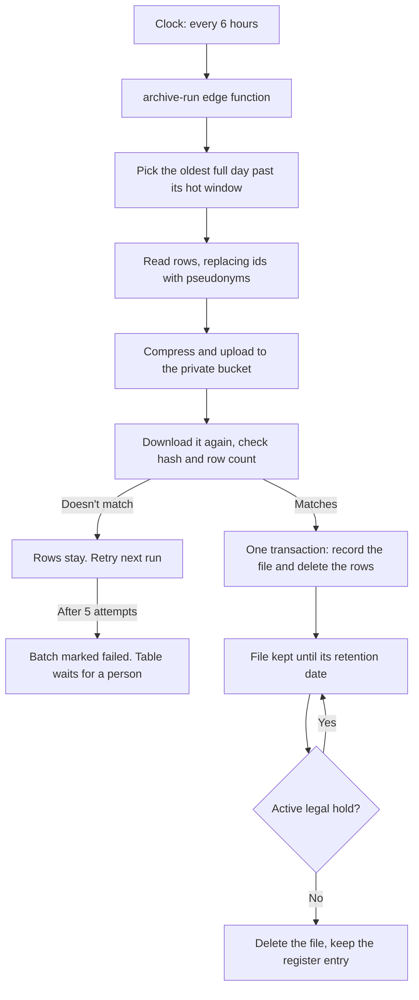

# Data retention and archiving

For whoever owns the Supabase project, and for whoever gives legal advice on it. It covers what we keep, for how long, where it goes, how it is destroyed, and what to do when something goes wrong.

> **The retention periods below are engineering defaults, not legal advice.** They need confirming by someone qualified for the countries we operate in, before we rely on them or publish them. See [Decisions still needed](#decisions-still-needed).

## In short

Logs and records that keep growing move out of the database once they are old enough to be rarely needed. They go into compressed files in a private storage bucket, where they stay until their retention date and are then destroyed. A permanent register records every file, including proof that it was destroyed on time.

- **Nothing is deleted from the database until its file has been uploaded, read back and checked.** If any step fails, the rows stay where they are.
- **Archive files don't identify members directly.** User ids are replaced with pseudonyms, and deleting an account deletes the link back to that person.
- **A legal hold stops a file from being destroyed** for as long as the hold is active.

## What we keep, and for how long

"Hot" means in the database and visible in the admin area. "Total" counts from the row's date and includes the hot period.

### Archived, then destroyed

| Data | Table | Hot | Total | Counted from | Removed from the file |
|---|---|---|---|---|---|
| Application logs | `app_logs` | 30 days | 1 year | Created | `context` (page path, stack trace) |
| Staff audit log | `admin_audit_log` | 1 year | 5 years | Created | `target_email`, and the `email` inside `detail` |
| Restrictions, appeals, exemptions | `accountability_audit` | 1 year | 3 years | Created | Nothing |
| Bans and suspensions | `moderation_actions` | 1 year | 3 years | Created | Nothing |
| Safety reports and their evidence | `reports` | 1 year | 3 years | **Resolved** | Nothing |

An open report has no resolved date, so it never moves, however old it is.

### Deleted with no archive

| Data | Table | Kept for | Why no archive |
|---|---|---|---|
| Uptime heartbeats | `system_heartbeats` | 90 days | No personal data, no later use |
| Push send records | `message_push_claims` | 30 days | Only stops a push being sent twice |
| **Read** notifications | `notifications` | 180 days after reading | Already seen. Unread ones stay. |
| Scheduler run history | `cron.job_run_details` | 14 days | Only used to show recent job status |

Rate limit counters already clean up after themselves (`rate_limit_cleanup`).

### Deliberately not archived

These stay in the database for as long as the account exists, and go when it is deleted.

- **Messages and chats.** The privacy policy says "your chats are yours" and that deleting an account removes them. Keeping a copy for years would contradict that, and nothing we've identified requires it. The only message text we keep is what a report captured as evidence.
- **Everything else a member owns:** profile, posts, corrections, phrases, translation history, points and consents.

## How it works



| Piece | Where | Job |
|---|---|---|
| `retention_policies` | Database | The rules: one row per table |
| `archive_batches` | Database | The register: one row per file, with hash, row count and dates. Never deleted. |
| `archive_legal_holds` | Database | Date ranges that must not be destroyed |
| `archive_subjects` | Database | Links a user id to its pseudonym. Deleted with the account. |
| `archive_settings` | Database | The function's URL and secret. Filled in by hand once. |
| `archive-run` | Edge function | Does the file work. All decisions about deleting are made in the database. |
| `archives` | Storage bucket | The files. Private, with no access policies, so only the service role can reach it. |
| `ft-archive-run` | pg_cron, every 6 hours | Starts `archive-run` |
| `ft-archive-purge` | pg_cron, hourly | Runs the deletes that have no archive, up to 5,000 rows per table each hour |

### The files

Each file holds one UTC day of one table: `archives/<table>/<yyyy>/<mm>/<yyyy-mm-dd>.p<part>.ndjson.gz`. It's gzipped text with one JSON object per line, so it can be read for years without any of our code.

A sealed file is never changed. If a row later turns up for a day that is already archived, it goes into a new file (`.p2`).

### What protects the data

| Risk | What stops it |
|---|---|
| Rows deleted but the file is bad | Rows are only deleted after the stored file is downloaded again and its SHA-256 and row count match |
| File recorded but rows not deleted, or the reverse | Both happen in one database transaction |
| Rows changed between reading and deleting | The row count is checked again before and after the delete. Any difference undoes the transaction and the batch retries. |
| Audit log deleted through this route | `admin_audit_log` stays append-only. Deleting is allowed only for rows in a batch being sealed, and that state exists only inside the sealing transaction. Updates are always refused. |
| A failure that keeps repeating | After 5 attempts the batch is marked failed and that table stops. Nothing is lost, and it shows in red on the Health page. |
| Someone calling the steps directly | The `svc_archive_*` functions are only for the service role, and the function requires its own secret |

## Deleted accounts

Files can't be rewritten, so they never hold a member's real id. They hold a random pseudonym from `archive_subjects`, and that row is deleted automatically with the account. From then on, nothing in our systems links any file to that person, without touching a single file. An account that is already gone when a file is written gets `null`.

This covers `user_id`, `actor_id`, `target_user`, `target_user_id`, `target_id`, `reporter_id`, and `sender_id` inside report evidence.

**What this doesn't do:**

- **Free text is not scrubbed.** Report details, message text in evidence, log messages and moderation reasons can contain a name someone typed. This is why deleting an account may reduce these files to pseudonymous rather than fully anonymous data, and legal should look at it.
- **Staff stay named** in `admin_audit_log` (`actor_id`, `actor_email`), and by id in `moderation_actions` (`admin_id`) and `reports` (`resolved_by`). They acted on behalf of the service, and this record is what makes the log useful as evidence. Those ids are only linked to a person while the account exists, except the audit log's `actor_email`, which stays in the file.
- **Hot rows follow their existing rules until they move.** `app_logs.user_id`, `admin_audit_log.target_email` and the `sender_id` in report evidence are not cleared when an account is deleted, so they can sit in the database for the rest of the hot period.
- **Database backups** still contain deleted rows until those backups age out, on whatever schedule your Supabase plan uses.

## Common tasks

Run the SQL in the Supabase dashboard's SQL editor. These tables aren't reachable from the API, on purpose.

### Place or lift a legal hold

Place a hold as soon as you know a claim, investigation or authority request is likely. Holds work on date ranges of the date the row is filed under. Use `null` for the table to cover everything. If you're unsure of the dates, go wide.

```sql
insert into public.archive_legal_holds (table_name, from_day, to_day, reason, placed_by)
values (null, '2026-01-01', '2026-06-30', 'Claim ref 123, per counsel', 'name of the person placing it');

-- Lifting: the row stays, as the record.
update public.archive_legal_holds set released_at = now(), released_by = 'name'
where id = '<hold id>';
```

**A hold does not protect an account.** If the person involved deletes their account, the link to their pseudonym goes, even under a hold. If you need to keep it, take a copy of the mapping first:

```sql
select user_id, pseudonym from public.archive_subjects where user_id = '<user id>';
```

### Find and read an archived record

1. Find the file in the register:
   ```sql
   select object_path, row_count, sha256, retain_until from public.archive_batches
   where table_name = 'reports' and status = 'released' and day between '2026-01-01' and '2026-01-31' order by day, part;
   ```
2. Download it from **Storage → archives** in the dashboard.
3. Confirm it hasn't changed, then read it. The hash must match the register.
   ```bash
   sha256sum 2026-01-15.p1.ndjson.gz
   gunzip -c 2026-01-15.p1.ndjson.gz | jq .
   ```
4. To follow a person, look up their pseudonym, then search the files for it:
   ```sql
   select pseudonym from public.archive_subjects where user_id = '<user id>';
   ```

**Keep your own note of each retrieval: who, when, which file and why.** Dashboard downloads aren't written to our audit log.

Requests from members for their own data are still answered by the export in Settings, which reads live data only. If a request needs archived records too, follow these steps for that person's pseudonym.

### Retry a failed batch

Find out why it failed, and fix the cause first:

```sql
select id, table_name, day, last_error, attempts from public.archive_batches where status = 'failed';
```

Then send it back. The next run picks it up, and you can start one straight away with `select public.archive_kick();`.

```sql
update public.archive_batches set status = 'exporting', attempts = 0, last_error = null, claimed_at = null where id = '<batch id>';
```

### Change a retention period

```sql
update public.retention_policies set retain_days = 730, basis = 'Why it changed, and who approved it' where table_name = 'app_logs';
```

This applies to files written from now on. Files that already exist keep their date, so nothing is destroyed early by accident. To change those too, do it deliberately:

```sql
update public.archive_batches set retain_until = day + 730 where table_name = 'app_logs' and status = 'released';
```

### Add a table

Add a row to `retention_policies` in a new migration. An `archive` table needs an `id` column and a date column, must have no other table depending on its rows, and must list every column that holds a user id in `subject_columns`. Add a test to `supabase/tests/app_flow.sql` that checks no raw id reaches the file.

### Pause it

```sql
update public.retention_policies set enabled = false where table_name = 'app_logs';  -- one table
select cron.unschedule('ft-archive-run');                                            -- all archiving
select cron.unschedule('ft-archive-purge');                                          -- all deletes with no archive
```

Stopping `ft-archive-run` also stops destruction, which is a retention problem of its own if it's left off.

## Setup

The order matters. The migration stops the old 30-day log delete straight away, so **until step 3 is finished, `app_logs` keeps growing and nothing gets archived**. No data is lost in that gap, and the Health page shows "Archive set up: No".

1. **Database.** Run `supabase db push`. It pushes every migration not yet applied, not only this one. In the dashboard, check that **pg_cron** and **pg_net** are enabled under Database → Extensions.
2. **Function.**
   ```bash
   openssl rand -hex 32    # the secret: use the same value in both places
   supabase secrets set ARCHIVE_WEBHOOK_SECRET=<secret>
   supabase functions deploy archive-run --no-verify-jwt
   ```
3. **Connect them** in the SQL editor:
   ```sql
   insert into public.archive_settings (function_url, webhook_secret)
   values ('https://<project-ref>.supabase.co/functions/v1/archive-run', '<secret>');
   ```
4. **Website.** Deploy as usual to get the Data archive panel on the Health page.
5. **Check it.**
   ```sql
   select jobname, schedule, active from cron.job where jobname like 'ft-archive%';   -- two rows
   select public.archive_kick();                                                      -- start a run now
   select table_name, day, status, row_count, last_error from public.archive_batches order by created_at desc limit 10;
   ```
   An empty register after a run is normal if nothing is past its hot window yet. `app_logs` will be first, 30 days after the migration. Check `select status_code, content from net._http_response order by created desc limit 1;` for the run's own answer, such as `{"files":0,"rows":0,"destroyed":0,"failed":[]}`.

If `cron.job` shows no rows, enable pg_cron and run the two `cron.schedule` lines from `supabase/migrations/20261103000003_data_archive.sql`.

## Keeping an eye on it

**Admin → Health → Data archive** shows the state of all this. Anything it flags also appears in the banner at the top of the page. Failures in a run are also written to the logs, under `edge:archive-run`.

| It shows | Meaning | Do this |
|---|---|---|
| Archive set up: No | `archive_settings` is empty | Setup, step 3 |
| Failed archive files above 0 | A table has stopped archiving. Its rows are safe in the database. | [Retry a failed batch](#retry-a-failed-batch) |
| Oldest rows waiting, flagged | More than 2 days past the hot window: runs aren't happening | Check `ft-archive-run` under Scheduled jobs, then the function's logs. The usual cause is a mismatch between the secret and `archive_settings`. |
| Files past their destroy date above 0 | Files should have been destroyed and weren't. This is a retention breach if it lasts. | Same checks, then look for `destroy` errors in the logs |

Review this page at least once a month. Nothing alerts anyone by email yet.

## Limits worth knowing

- **Files can be altered by anyone with full project access.** The service role and dashboard owners can delete a file. The hash in the register shows a file has been changed, but the register sits in the same project, so someone with full access could change both. If legal needs tamper-proof evidence, add a second copy in write-once storage (S3 or R2 with object lock) under a different account. Not built.
- **Archives are in one place.** They have Supabase Storage's durability and no copy of our own. Database backups don't cover Storage file contents, so losing the project would lose the archive too. A copy elsewhere fixes both this and the point above.
- **Each file must fit in one function run:** under 50 MB compressed (the Free plan's maximum object size, and the bucket's limit) and within the platform's time limit. If a very busy day goes over, the batch fails safely and that table stops. The fix is a higher limit on a paid plan, or splitting days into smaller files.
- **Storage is counted in the plan's quota.** Old data costs less here than in the database, but it isn't free. The Health panel shows the running total.
- **Admin screens only show hot data.** After a year, a ban or report no longer appears in the admin area, and someone has to go to the archive for it.

## Decisions still needed

**For legal advice:**

1. **Which countries' rules apply?** Everything else depends on this. The privacy policy names GDPR and CCPA principles.
2. **Are the periods right?** Storage limitation (GDPR Art. 5(1)(e)) means keeping data too long is a breach as well, so longer isn't automatically safer. Please check the 5 years for the staff audit log and the 3 years for reports in particular, since reports contain message text.
3. **Is keeping reports and logs after account deletion justified?** The current assumption is that they're needed for safety and legal claims (GDPR Art. 17(3)(e)), and that the pseudonym approach is enough. Free text is the weak point.
4. **Proof of consent.** The `consents` table is deleted with the account, so we can't later show someone agreed to the terms. You may want a pseudonymised copy kept for a period.
5. **Tamper-proof storage:** is it required? See [Limits](#limits-worth-knowing).

**For the policy pages (not changed yet, and this should happen before relying on this system):**

Privacy law generally expects retention periods to be disclosed (GDPR Art. 13(2)(a)), and the current pages don't state them. [Privacy.tsx](../src/pages/public/Privacy.tsx) and [DataDeletion.tsx](../src/pages/public/DataDeletion.tsx) only mention reports as being kept after deletion. Once the periods are confirmed, wording along these lines would close the gap:

> **How long we keep things.** Your profile, messages and saved content stay until you delete them or your account. Technical logs are kept for up to 1 year, and safety reports and records of moderation decisions for up to 3 years. Records of what our staff do are kept for up to 5 years. Older records are moved to private storage and then permanently destroyed. If you delete your account, what remains is no longer linked to your account, though it may include words someone wrote. We may keep specific records longer if the law requires it or for a legal claim.

## Testing

| What | How |
|---|---|
| The rules: pseudonyms, row checks, append-only, holds, purges, permissions | `npm run test:db`, in `supabase/tests/app_flow.sql` |
| The file format | `npm run test:unit`, in `tests/unit/archiveFile.test.ts` |
