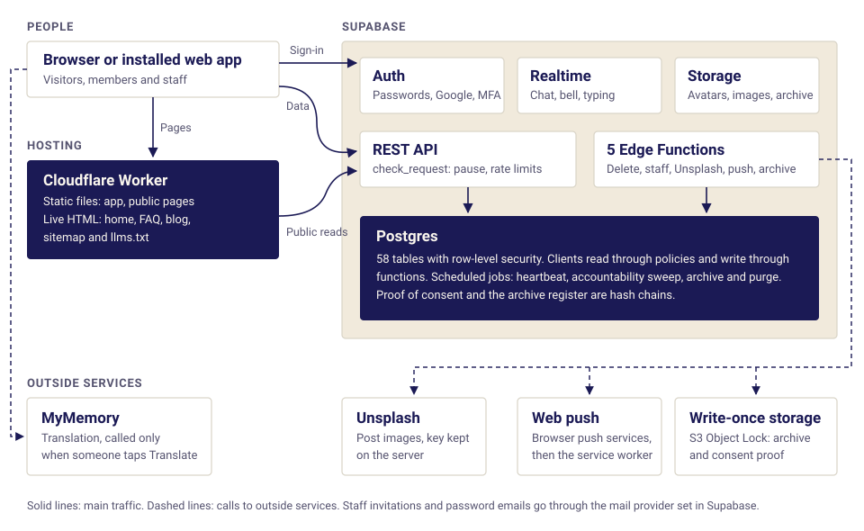

# The Fluency Talks: project documentation

**Website:** [thefluencytalks.com](https://thefluencytalks.com) · **Status as of:** 3 November 2026

This document describes the whole application: what it does, how it's built, how it's run and what's still open. Anyone can read it without knowing the code. Each section ends with the file holding the full detail.

## Contents

1. [Summary](#1-summary)
2. [The product](#2-the-product)
3. [What members can do](#3-what-members-can-do)
4. [Levels, points and bounties](#4-levels-points-and-bounties)
5. [Safety and moderation](#5-safety-and-moderation)
6. [The staff area](#6-the-staff-area)
7. [The public website](#7-the-public-website)
8. [Design](#8-design)
9. [Technical architecture](#9-technical-architecture)
10. [The database](#10-the-database)
11. [Rules on every screen](#11-rules-on-every-screen)
12. [Security](#12-security)
13. [Data, privacy and retention](#13-data-privacy-and-retention)
14. [Legal status](#14-legal-status)
15. [Running the application](#15-running-the-application)
16. [Testing and quality](#16-testing-and-quality)
17. [Growth: search and AI visibility](#17-growth-search-and-ai-visibility)
18. [Roadmap, gaps and open decisions](#18-roadmap-gaps-and-open-decisions)
19. [Map of all documents](#19-map-of-all-documents)

## 1. Summary

The Fluency Talks is a free language exchange web app. People learning a language are matched with people who speak it, and they practise in text chat. A qualified partner can correct a sentence right where it was written, and the learner sees exactly what changed and can keep it.

| | |
|---|---|
| **Price** | Free, with no paid plans |
| **Languages** | 40 at launch, levels A1 to C2 |
| **Practice** | One-to-one text chat, with no voice or video |
| **Platform** | Web app, installable on a phone. Nothing to download |
| **Minimum age** | 16 |
| **Technology** | React and TypeScript, Supabase (Postgres), Cloudflare |
| **Legal regime** | Vietnamese data law |

**What's different about it:**

- Corrections happen inside the conversation.
- People are matched by language, not popularity.
- Levels are earned from real activity, not claimed.
- Helping others is rewarded through a small, auditable points system.

**Current state:** the features below are built and the site is live. The main things still open are [legal filings and decisions](#14-legal-status), [domain redirects](#domains), connecting the write-once archive store, and testing the keyboard behaviour on real phones.

## 2. The product

The Fluency Talks is a **study-partner platform, not a social network**. There are no follower counts, no likes and no popularity contest.

**Who it's for:** language learners at any level, such as students abroad and expats, and native or fluent speakers who want to help.

**An example.** Tom speaks English and is learning Vietnamese at A2. Linh, in Hanoi, speaks Vietnamese and is learning English. They match.

1. Tom writes *Tôi là đói*.
2. Linh corrects it to *Tôi đói*, and Tom sees the change in red and green. In Vietnamese, words like "hungry" work like verbs and take no "to be".
3. Tom accepts. Linh earns 5 points, and the corrected phrase goes into Tom's phrasebook.
4. Later, Tom is stuck on an exam phrase. He spends 50 points on a bounty, and a native speaker answers it.

**Principles**

- **Conversation first.** Text chat now.
- **Safe by design.** Blocking, reporting and message requests came before chat went live.
- **Earned, not claimed.** Only verified levels unlock the right to correct others.
- **Honest claims.** Every public statement describes something the app really does. There are no invented testimonials or made-up counts.
- **One design system,** with every colour and size in one file.
- **Portable.** Leaving Supabase should stay possible and touch few files.

**What it isn't.** It offers no voice or video, paid tutors, courses, certificates, native phone apps or AI tutor, and it isn't a dating or friend-making service.

*Full detail: [PRODUCT_OVERVIEW.md](PRODUCT_OVERVIEW.md)*

## 3. What members can do

**Accounts.** Sign up with email and password, or with Google. Passwords need at least 8 characters, and password reset is built in.

**Onboarding.** Choose one native language, optionally one learning language, and a level, then confirm age, terms and privacy. The first language change is free, then one every 30 days.

**Home feed.** One column mixing posts and people, always opening with posts and mostly posts. One person appears after every 3, 5, then 4 posts, and every third post slot goes to a request for help. Loading more never moves what's already on screen.

**Matching.** People are ranked by how well they fit, and each card says why:

1. **Swap:** each speaks what the other is learning. This is best, but never required.
2. **Teacher:** they speak what you are learning.
3. **Learner:** they are learning what you speak.
4. **Everyone else.**

Within a tier, recent activity comes first, then timezone closeness, then newest.

**Search.** Find anyone by name or `@username`, and search messages in your own chats, with filters for language, role, level and scope. The search lives in the URL, so it can be shared.

**Chat.** Message requests, realtime messages, replies, reactions, read receipts, typing indicators, online status, editing and deleting. Each message carries a language tag chosen by the sender. People can hide their activity status, and it hides both ways.

**Inline corrections.** A native speaker of the message's language, or a learner verified at B1 or above, can suggest a change with a note. The learner sees a word-level diff and accepts or declines. Declining needs a reason, which the helper is told. Accepted corrections go to the phrasebook automatically, and learners can rate them.

**Learning page.** Three tabs: saved phrases, corrections received and translations. Each row links back to the chat it came from.

**Translation.** "Translate" under a message shows it in your language and saves it to your history. Text goes to an outside provider, MyMemory, only when someone taps Translate.

**Community library.** Qualified speakers publish phrases, idioms, usage and grammar notes, with an optional image. Others save them, confirm them or propose corrections. Nothing is overwritten: the original stays, and the accepted version sits beside it. The post's owner decides on corrections, and moderators can step in with a reason.

**Accountability.** Corrections on a post create a decision for its owner, with reminders and a 7-day deadline. Three overdue decisions, after notice, pause new posts until they're answered. Owners can ask for one extension or appeal.

**Practice posts.** Beginners can ask for help with no level needed, using "Correct me" or "How do I say…?". They carry no duties, each fix shows as a diff, and qualified people are notified.

**Saved partners.** Private bookmarks, and the other person isn't told.

**Notifications.** A live bell and full page, plus optional web push. iPhones need the app added to the Home Screen for push.

**Profile and settings.** Name, username, bio, country, time zone, photo, email, password, activity status, blocked people, theme (light, dark or device), data export and account deletion.

*Full detail: [FEATURES.md](FEATURES.md), [POST_TYPES_AND_UNLOCKS.md](POST_TYPES_AND_UNLOCKS.md)*

## 4. Levels, points and bounties

### Earned levels

The level someone picks is only an estimate, and it unlocks nothing. A separate **verified level** rises by itself from real activity, and only that lets a learner correct others, answer bounties, post and earn in their learning language. Changing the learning language resets it.

| Level | Messages | Active days | Native partners | Reviewed | Max error % | Other |
|---|---|---|---|---|---|---|
| A1 | 5 | 1 | 0 | 0 | 100 | |
| A2 | 20 | 3 | 1 | 10 | 80 | |
| B1 | 80 | 7 | 2 | 40 | 50 | Or 2 vouches from native speakers who really chatted with the learner |
| B2 | 200 | 14 | 2 | 100 | 35 | 5 accepted corrections, 60% helpful |
| C1 | 400 | 30 | 3 | 200 | 20 | 20 accepted, 70% helpful, 3 post saves |
| C2 | 800 | 60 | 3 | 400 | 10 | 50 accepted, 80% helpful, 10 post saves |

### Points

| Event | Points |
|---|---|
| Starting balance | +100 |
| Your correction is accepted | +5 |
| Your bounty answer is accepted | +50 |
| You post a bounty | −50, held |
| Bounty expires, or its message is deleted | +50 back |
| Posting to the library | Nothing |

Every movement is one row in a ledger, so nothing pays twice and everything can be audited. Clients can't move points themselves. To stop farming, the +5 is limited to 10 a day per corrector and 3 a day from one author, and corrections must really change the text. Correctors whose recent ratings are mostly "not helpful" stop earning it until that recovers.

### Bounties

A learner spends 50 points to put a message in front of qualified speakers, and the composer warns that others will see the text. Each person may send one answer, and the asker picks one, whose author gets the 50. After 48 hours with no accepted answer, or if the message is deleted, the points come back. Each person may have up to 3 open at a time, and the data rules refuse invalid moves such as going from paid back to open.

*Full detail: [CORRECTIONS_AND_BOUNTIES.md](CORRECTIONS_AND_BOUNTIES.md)*

## 5. Safety and moderation

- **Message requests:** a first contact has to be accepted.
- **Blocking:** silent, two-way and enforced in every database read. A blocked person simply disappears.
- **Reporting:** nine reasons (harassment, spam, inappropriate, impersonation, underage, scam, fake correction, points abuse, other), with a snapshot of the evidence.
- **Automatic suspension:** five different people reporting someone within 7 days suspends the account until staff review it. This rule should be reviewed as part of the moderation policy.
- **Staff actions:** suspend, ban and reinstate always need a reason and are logged.

## 6. The staff area

Staff run the app rather than use it. They get a separate area at `/admin`, and every login needs a **password and a Google Authenticator code**.

| Role | How it's created | Can do |
|---|---|---|
| **Super admin** | An owner script, on one reserved address | Everything, including inviting and removing staff and resetting their MFA |
| **Admin** | Invited by the super admin | Reports, decisions, people, blog, FAQ, health, logs. Manages moderators and learners |
| **Moderator** | Invited by the super admin | Reports, decisions, people, blog, FAQ. Manages learners |

**Sections:** Overview, Reports, Decisions, People, Activity, Blog, FAQ, Notifications, Team, Health, Logs and Security.

**Separation.** Staff are hidden from learners, can't act as learners, and see only what's needed to make a decision. A learner invited to the team has their learner side closed while they're staff, and it comes back if they leave.

**Enforcement is in the database, not the screens.** Nobody can assign themselves a role, a stolen password alone gives no admin power, and the audit trail can't be edited or deleted through the app.

**Recovery.** Each staff member gets 10 recovery codes and can add a backup authenticator. The super admin can reset anyone's MFA. An owner script is the last resort for the super admin.

**Monitoring.** The Health and Logs pages show database uptime, browser errors from signed-in people, edge function failures, sign-ins and the archive state. An outside monitor is still recommended for the website itself.

*Full detail: [ADMIN_SETUP.md](ADMIN_SETUP.md), [URLS_AND_ACCESS.md](URLS_AND_ACCESS.md)*

## 7. The public website

- **Landing page:** what it is, how it works and a way to sign up.
- **40 language pages,** such as [/languages/vietnamese](https://thefluencytalks.com/languages/vietnamese), and a [languages index](https://thefluencytalks.com/languages).
- **[Blog](https://thefluencytalks.com/blog):** 13 published articles. Staff write and publish them without a deploy.
- **[FAQ](https://thefluencytalks.com/faq):** 21 questions, edited by staff, with the same no-deploy flow.
- **[About](https://thefluencytalks.com/about), [Privacy](https://thefluencytalks.com/privacy), [Terms](https://thefluencytalks.com/terms) and [Data deletion](https://thefluencytalks.com/data-deletion).**

Pages are real HTML, so search engines and AI crawlers can read them without running JavaScript.

## 8. Design

The look is a university prospectus rather than a software template: serif headlines, hairline rules and square-ish corners. Everything comes from one token file, so restyling the app means editing one file.

| Share | Colour | Used for |
|---|---|---|
| 60% | Warm paper | Backgrounds, cards, reading text |
| 30% | Deep indigo | Menus, bands, footer, navigation |
| 10% at most | Coral | Primary buttons, link underlines, active marks, focus rings. Never text on paper, because it fails contrast |

- **Type:** Newsreader for headlines and Source Sans 3 for body.
- **Themes:** light and dark.
- **Layout:** one column with a bottom tab bar on phones, an icon sidebar on tablets, and a full sidebar with a right rail on desktop.
- **Accessibility:** text meets WCAG AA contrast, tap targets aim for 44px, and animation switches off under `prefers-reduced-motion`.

*Full detail: [DESIGN_SYSTEM.md](DESIGN_SYSTEM.md)*

## 9. Technical architecture

| Layer | Technology |
|---|---|
| Frontend | React 18, Vite, TypeScript, React Router, Tailwind, Zustand |
| Backend | Supabase: Postgres, Auth, Realtime, Storage, 5 Edge Functions |
| Hosting | One Cloudflare Worker with static assets |
| Outside services | MyMemory, Unsplash, web push services, an S3 Object Lock store, an email provider |

**How a request flows.** Pages use components, components use services, and services call one function (`rpc()`) that cleans every argument. Before each API request, the database checks the pause switch and rate limits. Database functions then check blocks, account status and permissions.

**The core rule is that clients read through row-level security and write through functions.**

**The Worker.** Only the home page, FAQ, blog, sitemap and `llms.txt` run code. It serves them from the database as finished HTML, cached for 60 seconds. Everything else is a plain file.

| Edge Function | What it does |
|---|---|
| `delete-account` | Permanently deletes the calling user |
| `admin-staff` | Invitations and other staff actions that need elevated access |
| `unsplash-proxy` | Image search, keeping the key on the server |
| `send-push` | Delivers a notification to the owner's devices |
| `archive-run` | Archives old records and destroys expired files |

*Full detail: [ARCHITECTURE.md](ARCHITECTURE.md)*

## 10. The database

The database has 58 tables and about 240 functions, built by 20 migration files, one per area: foundation, accounts, staff, app controls, social graph, notifications, messaging, moderation, posts, corrections, phrasebook, points and levels, consent, archive, blog, reference data, legal documents, blog posts, FAQ and FAQ questions.

**Rules for changing it**

- Once a migration is pushed, change the database with a new file, never by editing the old one.
- New tables start closed, and need their own grants and row-level security.
- Each new function needs its own permission grants. A test fails otherwise.
- Test on a throwaway database before pushing.

**Main limits**

| What | Limit |
|---|---|
| Messages | 30 a minute |
| New chats | 20 a day |
| Chat corrections | 20 an hour, 30 a day |
| Library posts | 20 a day, 500 characters per field |
| Practice posts | 3 a day, 280 characters |
| Open bounties | 3 |
| Reports | 10 an hour |
| All writes by one person | 240 a minute |

*Full detail: [DATABASE.md](DATABASE.md)*

## 11. Rules on every screen

1. **No backend or crash text on screen.** Only messages we wrote reach users. A crash shows a friendly page, and the real error goes to the admin logs.
2. **No browser validation pop-ups.** Forms check input in code and show our own messages. A test fails if this comes back.
3. **Data is checked before the database.** Forms check their fields, and every database call cleans text and refuses invalid numbers. Text is cleaned but not HTML-escaped, because React escapes it on screen and escaping twice would store `don&#39;t`. Browser checks can be bypassed, so the database stays the authority.
4. **Phone keyboard.** The field being typed in moves into the space above the keyboard, and the page returns to where it was when the keyboard closes. **This has only been tested with a simulated keyboard so far, and needs checking on real phones, especially chat.**

*Full detail: [APP_WIDE_RULES.md](APP_WIDE_RULES.md)*

## 12. Security

**Data access**

- Row-level security covers all data, and new tables start closed.
- Members can read only `id`, `username`, `display_name` and `avatar_url` of other people directly. The rest goes through a function that respects blocks.
- Only the owner sees their notifications, and a staff member's name is never shown to a learner.
- Typing indicators use private channels checked against conversation membership.

**Images.** Only the avatars bucket holds user images: JPEG, PNG or WebP, up to 2 MB, in your own folder only. Post images are Unsplash links, so there's no moderation burden from uploads.

**Rate limits.** Every API request is counted per person, and limits can change with no deploy. Failed calls, plain reads and signed-out traffic aren't counted. Blocking heavy read traffic would need a gateway in front of Supabase.

**Pausing the app.** Admins can pause everything with an authenticator code and a reason:

| While paused | |
|---|---|
| API and new accounts | Refused for everyone but staff |
| Open tabs | Switch to a maintenance page |
| Decision deadlines | Stop counting, then move forward by the downtime |
| Public website and login | Stay up |
| Background jobs (push, archive) | Keep running |

**Known limits.** A staff member calling the API directly could read what any signed-in learner can, though private chats they aren't part of stay closed. A new staff member has only a password until they scan the QR code, so they should finish setup straight after accepting.

*Full detail: [SECURITY.md](SECURITY.md)*

## 13. Data, privacy and retention

Logs and records that keep growing move out of the database, into compressed files in private storage, with a second copy in write-once storage that nobody can alter before its date. When the date comes, both copies are destroyed, and a permanent register records it.

| Data | In the database | Total |
|---|---|---|
| Application logs | 30 days | 13 months |
| Staff audit log | 1 year | 5 years |
| Restrictions, appeals, bans, suspensions | 1 year | 3 years |
| Safety reports and evidence | 1 year | 3 years from being resolved |
| Proof of consent | | **Permanent** |
| Uptime heartbeats | 90 days | Not archived |
| Read notifications | 180 days | Not archived |

**Messages and chats aren't archived.** The privacy policy says your chats are yours, so they stay for as long as the account exists and go when it's deleted. The only message text kept is what a report captured as evidence.

**Safeguards**

- Nothing is deleted from the database until both copies have been read back and checked. If any step fails, the rows stay.
- **Tampering shows.** The consent ledger and archive register are hash chains, checked against write-once checkpoints on every run. If they differ, the Health page shows a red warning.
- **Archive files don't identify members directly.** Ids are replaced with pseudonyms, and deleting an account deletes the link. Free text isn't scrubbed, though, so legal should look at that.
- **Legal holds** stop files being destroyed.

**Member rights.** Settings offers a full data export and real account deletion. The privacy page publishes the legal response times: for example, a reply within 2 working days, and deletion within 20 days.

**Status.** All of this is built, but **the write-once store still has to be connected**. Until then, rows stay in the database and the Health page says so.

*Full detail: [DATA_RETENTION.md](DATA_RETENTION.md)*

## 14. Legal status

The app is developed to **Vietnamese law**: Law 91/2025/QH15, Decree 356/2025/ND-CP and Decree 333/2026/ND-CP. This summary was checked against English translations and a law firm's summary. It isn't legal advice, and a lawyer should confirm it.

**Open items that code can't fix**

1. **Cross-border transfer filing.** The database is in Ireland, and a dossier is due to the authority within 60 days of the first transfer.
2. **Storing data in Vietnam.** A company registered in Vietnam may have to store regulated data there, so the operator's registration decides whether the current hosting complies.
3. **Naming the data controller.** The privacy policy needs the legal name and address of whoever runs the service.
4. **Impact assessment and data protection personnel.** A dossier is due within 60 days of first processing, and whether exemptions apply needs checking.

**Product changes the law may require**

- Separate consent for each purpose, instead of one checkbox.
- Telling existing members about the newer privacy policy.
- Reviewing cookie and "do not track" rules.
- A Vietnamese-language policy.
- Reviewing Decree 147/2024's account verification rules.
- Confirming the intended age, since the app says 16 while a stored consent name says `age_18`.

**For a lawyer to confirm:** permanent consent proof, 100-year storage locks, whether the log rule covers Supabase's own auth logs, and the retention periods themselves.

*Full detail: [LEGAL_COMPLIANCE.md](LEGAL_COMPLIANCE.md)*

## 15. Running the application

**Deploying.** The order always matters: **database, then functions, then website**.

**Local development.** A local Supabase stack runs in Docker. The repository is linked to production and `.env` usually points there, so local commands need `--local`.

### Domains

| Address | State on 3 November 2026 |
|---|---|
| `thefluencytalks.com` | **Working.** This is the only address to share |
| `www.thefluencytalks.com` | **Doesn't resolve.** Needs a DNS record and a redirect |
| `fluencytalks.com`, `www.fluencytalks.com` | **Redirect to an outside `l.ink` address.** Check who controls these |
| `fluency-talks.vercel.app` | **An old copy is still online,** and the GitHub repository's Website field points to it |

**Setup still to confirm**

- The hosted database's migration history may need a one-time repair after the 3 November consolidation.
- Web push needs its keys and function.
- The archive needs its write-once bucket.
- Scheduled jobs need pg_cron and pg_net enabled.

*Full detail: [DEPLOYMENT.md](DEPLOYMENT.md), [LOCAL_DEVELOPMENT.md](LOCAL_DEVELOPMENT.md)*

## 16. Testing and quality

| Check | What it covers | Runs in CI |
|---|---|---|
| Type check | The whole app | Yes |
| Auth tests | Sign-in helpers | Yes |
| Build and SEO check | What a crawler sees on every public page | Yes |
| Legal check | Published text matches its recorded version | Yes |
| Database test | Builds from scratch, matches every app call to a real function, and replays the app's flows | Yes |
| Unit tests | Feed mix, validation, keyboard, blog HTML, archive files | No, by hand |
| Security test | Real API, Storage and Realtime access | No, local stack |
| Staff test | Real Auth, TOTP, edge function and email | No, local stack |

*Full detail: [TESTING.md](TESTING.md)*

## 17. Growth: search and AI visibility

**Being crawlable.** Public pages are plain HTML, with a unique title, description and canonical URL, one H1, and structured data. Private areas are kept out of search: sign-in pages with `noindex`, and app pages through `robots.txt` and login.

**The sitemap** lists 61 URLs: 8 core pages, 13 articles and 40 language pages. Submit that one file in Google Search Console and Bing Webmaster Tools, then request indexing for about ten key pages.

**AI assistants.** Google's AI answers come from its normal index, and ChatGPT search and Copilot draw on search indexes too. What matters is being crawlable, being indexed, stating facts plainly and consistently, and being mentioned by other sites. `llms.txt` exists but won't get you cited. Don't block AI crawlers, and check that Cloudflare's "Block AI bots" setting is off.

**Content plan.** One rule above all: **never target a search the product can't satisfy.** The focus languages are Vietnamese and Swahili, where competition is lowest. The calendar is 24 articles at 2 a month, starting November 2026, and each must show one real feature in use.

**Consistency.** The facts in [section 1](#1-summary) must match everywhere. A language page should only promise native speakers when at least 5 exist. Otherwise it invites people to help build that community.

**A plan, not built:** making member posts searchable with the author's opt-in, under a stable public URL. Profiles and chats would stay private. This is about two to three days of work plus tests, and it needs a team decision on consent and moderation first.

*Full detail: [SEO.md](SEO.md), [INDEXING_CHECKLIST.md](INDEXING_CHECKLIST.md), [GOOGLE_SEARCH_CONSOLE.md](GOOGLE_SEARCH_CONSOLE.md), [AI_VISIBILITY.md](AI_VISIBILITY.md), [CONTENT_PLAN.md](CONTENT_PLAN.md), [PUBLIC_CONTENT_SEO.md](PUBLIC_CONTENT_SEO.md)*

## 18. Roadmap, gaps and open decisions

**Not built yet**

- Voice and video
- A translated interface and right-to-left layout
- Further post types and looks (steps 2 to 4 of the ladder)
- Public library pages
- A bridge match tier through a shared third language
- A phrasebook review mode
- `/safety` and `/how-it-works` pages

**Known gaps**

- Domain issues ([above](#domains))
- The old follow system still in the database, though no screen shows it
- A possible false logout on a brief network failure
- Unit tests not in CI
- Medium buttons shorter than the intended 44px
- Oversized favicons
- Baseline measurements not yet collected, such as time to the first fix on a practice post

**Open decisions**

- Should the bridge match tier be on by default?
- Are the point values and limits final?
- Who may answer a bounty?
- Should practice posts launch in all languages, or only where helpers exist?
- Should library posts become public, with the author's opt-in?
- The legal items in [section 14](#14-legal-status).

*Full detail: [ROADMAP.md](ROADMAP.md), [PRODUCT_ANALYSIS.md](PRODUCT_ANALYSIS.md)*

## 19. Map of all documents

The full documents are in the project repository's `docs/` folder.

| Area | Document | What it explains |
|---|---|---|
| Start | [README.md](../README.md) | Introduction, quick start and commands |
| Product | [PRODUCT_OVERVIEW.md](PRODUCT_OVERVIEW.md) | What it is, principles and key facts |
| | [FEATURES.md](FEATURES.md) | Every feature in detail |
| | [CORRECTIONS_AND_BOUNTIES.md](CORRECTIONS_AND_BOUNTIES.md) | Correction systems and state machines |
| | [POST_TYPES_AND_UNLOCKS.md](POST_TYPES_AND_UNLOCKS.md) | Help posts and the proposed ladder |
| | [ROADMAP.md](ROADMAP.md) | Built, not built, gaps and decisions |
| | [PRODUCT_ANALYSIS.md](PRODUCT_ANALYSIS.md) | The original plan, kept as history |
| Engineering | [ARCHITECTURE.md](ARCHITECTURE.md) | Stack, folders, flow and scripts |
| | [DATABASE.md](DATABASE.md) | Migrations, tables, rules and limits |
| | [APP_WIDE_RULES.md](APP_WIDE_RULES.md) | Errors, validation and keyboard |
| | [DESIGN_SYSTEM.md](DESIGN_SYSTEM.md) | Tokens, colour and layout |
| | [URLS_AND_ACCESS.md](URLS_AND_ACCESS.md) | Every route and who can reach it |
| | [LOCAL_DEVELOPMENT.md](LOCAL_DEVELOPMENT.md) | Running it locally |
| | [TESTING.md](TESTING.md) | Tests and CI |
| Operations | [DEPLOYMENT.md](DEPLOYMENT.md) | Deploying, variables and domains |
| | [ADMIN_SETUP.md](ADMIN_SETUP.md) | Staff accounts, MFA and recovery |
| | [SECURITY.md](SECURITY.md) | Access rules and incident steps |
| | [DATA_RETENTION.md](DATA_RETENTION.md) | Retention, archive and tamper protection |
| | [LEGAL_COMPLIANCE.md](LEGAL_COMPLIANCE.md) | Legal regime and open items |
| Growth | [SEO.md](SEO.md) | On-page rules and prerendering |
| | [INDEXING_CHECKLIST.md](INDEXING_CHECKLIST.md) | What to submit, and in what order |
| | [GOOGLE_SEARCH_CONSOLE.md](GOOGLE_SEARCH_CONSOLE.md) | Search Console routine |
| | [AI_VISIBILITY.md](AI_VISIBILITY.md) | Being found in AI answers |
| | [CONTENT_PLAN.md](CONTENT_PLAN.md) | Keywords, pages and article calendar |
| | [PUBLIC_CONTENT_SEO.md](PUBLIC_CONTENT_SEO.md) | Plan for searchable member posts |
